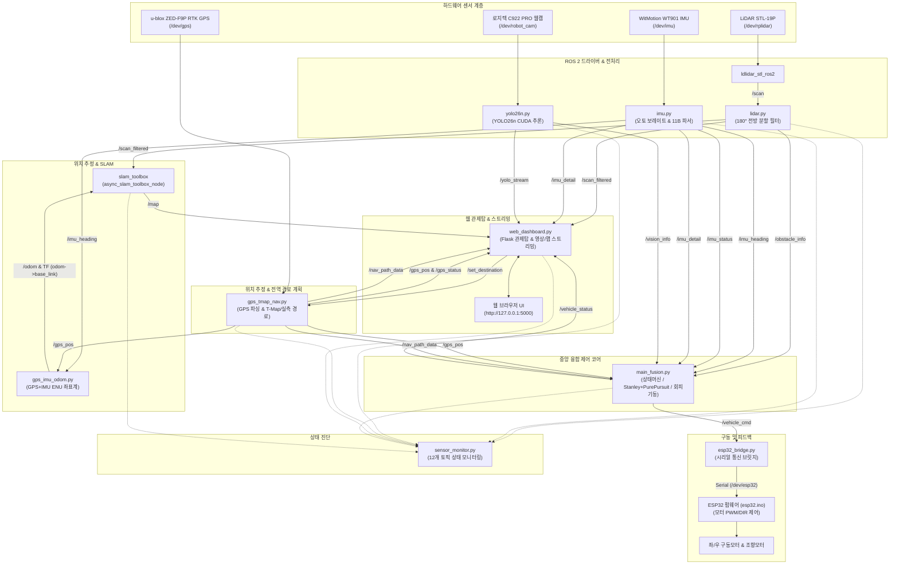
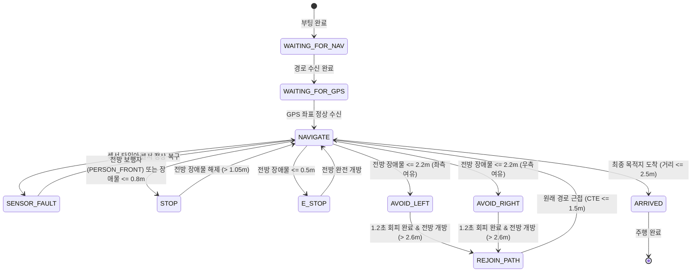

# 🏎️ 젯슨 오린 나노 & ESP32 기반 자율주행 고카트 시스템

> **Jetson Orin Nano**와 **ESP32** 기반의 하드웨어 분산 제어, **ROS 2 Humble** 통신 프레임워크, **센서 융합(LiDAR, Camera, IMU, GPS)**, **T-Map API & 정밀 실측 경로 계획**, **SLAM Toolbox 맵핑**, 그리고 **사이버펑크 웹 관제탑(Cyberpunk GCS)**을 아우르는 엔드투엔드(End-to-End) 자율주행 모빌리티 프로젝트입니다.

---

## 📌 목차
1. [시스템 개요](#1-시스템-개요)
2. [하드웨어 구성 및 핀맵](#2-하드웨어-구성-및-핀맵)
3. [전체 시스템 아키텍처 & 데이터 흐름도](#3-전체-시스템-아키텍처--데이터-흐름도)
4. [프로젝트 파일 구조 및 모듈별 심층 분석](#4-프로젝트-파일-구조-및-모듈별-심층-분석)
5. [핵심 제어 알고리즘 및 상태 머신](#5-핵심-제어-알고리즘-및-상태-머신)
6. [ROS 2 토픽 및 통신 규격 레퍼런스](#6-ros-2-토픽-및-통신-규격-레퍼런스)
7. [설치 및 실행 방법](#7-설치-및-실행-방법)
8. [개발 및 디버깅 가이드 (시뮬레이션 포함)](#8-개발-및-디버깅-가이드-시뮬레이션-포함)
9. [트러블슈팅 및 운영 팁](#9-트러블슈팅-및-운영-팁)

---

## 1. 시스템 개요

본 프로젝트는 고카트 형태의 자율주행 플랫폼으로, 상위 제어기(Jetson Orin Nano)와 하위 제어기(ESP32)가 시리얼 통신으로 유기적으로 결합되어 안전하고 정밀한 자율주행을 수행합니다.

- **상위 제어기 (Jetson Orin Nano)**:
  - OS: Ubuntu Linux (ROS 2 Humble)
  - 고속 센서 데이터 처리: LiDAR 180° 전방 감시, YOLO26 Nano 비전 인지(CUDA 가속)
  - 관성 항법 및 위치 추정: WitMotion WT901(BMI160+RM3100) 9축 IMU + u-blox ZED-F9P 센티미터급 RTK GPS 기반의 ENU 오도메트리 생성
  - 맵핑 및 위치 보정: SLAM Toolbox를 활용한 실시간 2D Occupancy Grid 생성
  - 경로 생성 및 판단: 교내 실측 정밀 경로 및 SK T-Map 보행자 경로 API 연동
  - 중앙 융합 제어: Pure Pursuit & Stanley 혼합 횡방향 조향 제어, 동적 램핑 속도 제어, 안전 상태머신
  - 웹 기반 관제탑(GCS): Flask + Leaflet 기반 4분할 사이버펑크 대시보드 (`http://127.0.0.1:5000`)
- **하위 제어기 (ESP32)**:
  - 3개 모터 구동: 좌/우 구동 모터(PWM + DIR) 2개, 전륜 조향 모터(PWM + DIR) 1개
  - 500ms 통신 두절 시 자동 정지(Watchdog Safety)

---

## 2. 하드웨어 구성 및 핀맵

### 2.1 하드웨어 장치 목록
| 장치명 | 모델 / 규격 | 통신 인터페이스 | 시스템 디바이스 경로 | 역할 |
|---|---|---|---|---|
| **메인 SBC** | NVIDIA Jetson Orin Nano | - | - | ROS 2, AI 비전, SLAM, 제어 코어, 웹 관제탑 |
| **모터 MCU** | ESP32 Dev Module | USB Serial (115200 bps) | `/dev/esp32` | 좌/우 모터 및 조향 모터 드라이버 제어 |
| **2D LiDAR** | STL-19P / LD19 (D500) | USB Serial | `/dev/rplidar` | 360° 레이저 스캔 (180° 전방 필터링, 장애물/연석 감지) |
| **9축 IMU** | WitMotion WT901 (BMI160+RM3100 9DOF) | USB Serial (자동 감지) | `/dev/imu` | Yaw 방위각, 각속도, 충격(BUMP) 감지 |
| **GPS 모듈** | u-blox ZED-F9P (센티미터급 차동 RTK GNSS) | USB Serial (115200 bps) | `/dev/gps` (`/dev/ublox_gps`) | WGS84 위도/경도 고정밀 수신 (RTK FIX/Float 지원) |
| **카메라** | 로지텍 C922 PRO HD Stream 웹캠 | V4L2 USB | `/dev/robot_cam` (`/dev/video*`) | 640x480 @ 30FPS AI 비전 인지 (보행자, 차량) |
| **구동 모터** | DC 모터 2개 (좌, 우) | 모터 드라이버 (PWM/DIR) | ESP32 GPIO | 고카트 전진/후진 추진력 제공 |
| **조향 모터** | DC 조향 모터 / 액추에이터 1개 | 모터 드라이버 (PWM/DIR) | ESP32 GPIO | 전륜 좌/우 랙앤피니언 조향 제어 |

### 2.2 ESP32 하드웨어 핀맵 (`esp32.ino`)
좌/우 구동 모터 및 조향 모터는 모터 드라이버(H-Bridge)의 PWM 및 DIR 핀에 아래와 같이 연결됩니다.

```
       [ ESP32 Dev Board ]
       ┌─────────────────┐
       │ GPIO 18 (PWM)   │ ────> 좌측 모터 PWM (속도: 0 ~ 255)
       │ GPIO 19 (DIR)   │ ────> 좌측 모터 DIR (HIGH: 전진, LOW: 후진)
       │ GPIO 21 (PWM)   │ ────> 우측 모터 PWM (속도: 0 ~ 255)
       │ GPIO 22 (DIR)   │ ────> 우측 모터 DIR (HIGH: 전진, LOW: 후진)
       │ GPIO 25 (PWM)   │ ────> 조향 모터 PWM (기본 속도: 70)
       │ GPIO 26 (DIR)   │ ────> 조향 모터 DIR (좌회전 / 우회전 전환)
       └─────────────────┘
```

> **조향 방향 설정 참고 (`esp32.ino`)**:  
> `REVERSE_STEER_MOTOR` 상수를 `true` 또는 `false`로 설정하여 조향 모터의 회전 방향을 손쉽게 반전시킬 수 있습니다.

---

## 3. 전체 시스템 아키텍처 & 데이터 흐름도

시스템은 센서 입력층(Sensing), 인지/위치추정층(Perception & Localization), 전역 경로 및 관제층(GCS & Routing), 중앙 융합제어층(Decision & Control), 액추에이션층(Actuation)으로 계층화되어 있습니다.



---

## 4. 프로젝트 파일 구조 및 모듈별 심층 분석

### 4.1 파일 목록 및 개요
| 파일명 | 역할 | 주 언어/포맷 | 주요 통신 및 연동 대상 |
|---|---|---|---|
| [`start.sh`](file:///c:/Users/포항고/Desktop/10.26_realcode/start.sh) | 전체 시스템 원클릭 백그라운드 구동 및 안전 종료 스크립트 | Bash | 모든 ROS 2 노드, 브라우저 자동 실행 |
| [`esp32.ino`](file:///c:/Users/포항고/Desktop/10.26_realcode/esp32.ino) | (레거시 수동) ESP32 모터 제어 펌웨어 (오픈루프 On/Off 조향) | C++ (Arduino) | ESP32 하드웨어, 시리얼 통신 |
| [`esp32_auto.ino`](file:///c:/Users/포항고/Desktop/10.26_realcode/esp32_auto.ino) | (자율주행 정밀제어) 32번 핀 가변저항 피드백 폐루프(Closed-loop) PID 조향 펌웨어 | C++ (Arduino) | 32번 핀 ADC, 모터 드라이버, 젯슨 시리얼 텔레메트리 |
| [`esp32_bridge.py`](file:///c:/Users/포항고/Desktop/10.26_realcode/esp32_bridge.py) | ROS 2 ↔ ESP32 양방향 시리얼 통신 브릿지 | Python (ROS 2) | `/vehicle_cmd`, `/esp32_raw_status`, `/dev/esp32` |
| [`lidar.py`](file:///c:/Users/포항고/Desktop/10.26_realcode/lidar.py) | 전방 180° 라이다 데이터 전처리, 노이즈 필터링, 장애물 분류 | Python (ROS 2) | `/scan` → `/obstacle_info`, `/scan_filtered` |
| [`imu.py`](file:///c:/Users/포항고/Desktop/10.26_realcode/imu.py) | WitMotion WT901 (BMI160+RM3100) 9축 IMU 자동 보레이트 매칭, 11B 패킷 디코딩, 충격 감지 | Python (ROS 2) | `/dev/imu` → `/imu_heading`, `/imu_status`, `/imu_detail` |
| [`yolo26n.py`](file:///c:/Users/포항고/Desktop/10.26_realcode/yolo26n.py) | YOLO26n (YOLO26 Nano) 비동기 카메라 수신, 보행자/차량 인식, 중앙 ROI 필터링 | Python (ROS 2) | V4L2 → `/vision_info`, `/yolo_stream` |
| [`gps_imu_odom.py`](file:///c:/Users/포항고/Desktop/10.26_realcode/gps_imu_odom.py) | GPS 위경도 + IMU 방위각을 융합하여 로컬 ENU 오도메트리/TF 생성 | Python (ROS 2) | `/gps_pos`, `/imu_heading` → `/odom`, TF(`odom`→`base_link`) |
| [`main_fusion.py`](file:///c:/Users/포항고/Desktop/10.26_realcode/main_fusion.py) | 자율주행 의사결정 중앙 제어 코어 (상태머신, 조향/속도 연산, 회피) | Python (ROS 2) | 센서 토픽 수신 → `/vehicle_cmd`, `/vehicle_status` 발행 |
| [`gps_tmap_nav.py`](file:///c:/Users/포항고/Desktop/10.26_realcode/gps_tmap_nav.py) | u-blox ZED-F9P RTK GPS 수신 및 T-Map/교내 실측 전역 경로 계획 | Python (ROS 2) | `/dev/gps` → `/gps_pos`, `/gps_status`, `/nav_path_data`, `/set_destination` |
| [`web_dashboard.py`](file:///c:/Users/포항고/Desktop/10.26_realcode/web_dashboard.py) | Flask 기반 사이버펑크 4분할 실시간 웹 관제탑 및 비디오/레이더 스트리밍 | Python (Flask+ROS 2) | 웹 클라이언트 ↔ `/set_destination`, `/video_feed`, 텔레메트리 |
| [`tmap.py`](file:///c:/Users/포항고/Desktop/10.26_realcode/tmap.py) | (레거시 통합본) GPS 수신 및 관제탑 웹 서버 일체형 파일 | Python (Flask+ROS 2) | 단일 프로세스 구동 호환성 유지용 |
| [`slam_mapping.launch.py`](file:///c:/Users/포항고/Desktop/10.26_realcode/slam_mapping.launch.py) | 정적 TF(`base_link`→`laser`) 브로드캐스팅 및 SLAM Toolbox 런치 | Python (Launch) | `slam_toolbox`, `rviz2` |
| [`slam_toolbox_params.yaml`](file:///c:/Users/포항고/Desktop/10.26_realcode/slam_toolbox_params.yaml) | 2D LiDAR 비동기 SLAM Toolbox 설정 파라미터 파일 | YAML | Ceres Solver, 루프 클로징, 격자 해상도(0.05m) |
| [`sensor_monitor.py`](file:///c:/Users/포항고/Desktop/10.26_realcode/sensor_monitor.py) | 시스템 11개 주요 토픽의 데이터 주기 및 수신 상태 진단 데몬 | Python (ROS 2) | 전체 토픽 헬스체크 |
| [`preview_dashboard.py`](file:///c:/Users/포항고/Desktop/10.26_realcode/preview_dashboard.py) | ROS 2 환경 없이 일반 PC에서 관제 UI를 테스트하는 가상 시뮬레이터 | Python (표준 라이브러리) | 로컬 포트 5000 웹 서버 |
| [`dashboard_preview.md`](file:///c:/Users/포항고/Desktop/10.26_realcode/dashboard_preview.md) | 관제 대시보드 화면 구성 및 사용법 설명 문서 | Markdown | 문서 안내 |
| [`esp32_pinmap.png`](file:///c:/Users/포항고/Desktop/10.26_realcode/esp32_pinmap.png) | ESP32 및 모터 드라이버 배선 다이어그램 이미지 | PNG Image | 하드웨어 참조 |

---

### 4.2 모듈별 상세 코드 동작 분석

#### 1) `start.sh` (통합 기동 스크립트)
- **사전 정리**: 포트 `5000` 사용 프로세스 및 잔여 Python/SLAM 노드를 강제 종료(`pkill -9`, `fuser -k`).
- **하드웨어 권한 개방**: `sudo chmod 666 /dev/esp32 /dev/rplidar /dev/imu /dev/ublox_gps /dev/camera /dev/video*`.
- **단계별 프로세스 구동**:
  1. `ld19.launch.py`: 라이다 하드웨어 구동
  2. `lidar.py`: 라이다 180도 필터링
  3. `imu.py`: IMU 방위각 수신
  4. `yolo26n.py`: YOLO AI 객체 인식
  5. `gps_imu_odom.py`: GPS/IMU 오도메트리 생성
  6. `main_fusion.py`: 메인 제어 코어
  7. `tmap.py`: 관제탑 웹 서버 및 GPS 수신
  8. `esp32_bridge.py`: ESP32 모터 통신 브릿지
  9. `sensor_monitor.py`: 센서 모니터링 데몬
  10. `slam_mapping.launch.py`: SLAM Toolbox 맵핑
- **브라우저 자동 실행**: 포트 5000 웹 서버가 정상 응답할 때까지 최대 15초간 대기(`curl -s`) 후 브라우저 오픈.
- **안전 종료 트랩**: `SIGINT` (Ctrl+C) 또는 `SIGTERM` 수신 시 실행된 모든 백그라운드 PID를 안전하게 종료(`cleanup()`).

#### 2) `esp32.ino` (ESP32 모터 제어 펌웨어)
- **안전 워치독 (`WATCHDOG_TIMEOUT_MS = 500`)**:
  - 시리얼 명령이 500ms 이상 들어오지 않으면 `is_armed = false`로 전환하고 모든 모터를 즉시 정지시킵니다.
- **주행 모터 제어 (`controlDriveMotors`)**:
  - `target_drive_pwm > 0`: `DIR_PIN = HIGH`, 전진 PWM 출력
  - `target_drive_pwm < 0`: `DIR_PIN = LOW`, 후진 PWM 출력
  - `target_drive_pwm == 0`: PWM 0 (정지)
- **조향 모터 제어 (`controlSteerMotor`)**:
  - 가변저항 피드백 없이도 직접 조향이 가능하도록 설계:
    - `target_steer_angle > 10.0`: 우회전 (지정 속도 `MANUAL_STEER_PWM = 70`)
    - `target_steer_angle < -10.0`: 좌회전 (지정 속도 `MANUAL_STEER_PWM = 70`)
    - 데드존(-10.0 ~ 10.0): 정지 (PWM 0)

#### 3) `esp32_auto.ino` (32번 핀 가변저항 피드백 폐루프 자율주행 펌웨어)
- **32번 핀 아날로그 ADC 수신**: 핸들에 부착된 가변저항 값을 저주파 EMA 필터링(`0.8 * prev + 0.2 * raw`)을 거쳐 안정적인 현재 조향 각도(`current_steer_angle`, ±35.0°)로 변환.
- **정지 시 조향 모터 완전 OFF (영점 캘리브레이션 모드)**: 차량이 정지 상태(`PWM == 0`)일 때는 조향 모터 전원을 완전히 차단하여, 정지 마찰력으로 인한 기어 파손을 방지하고 사용자가 손으로 자유롭게 핸들을 돌려가며 웹 대시보드 화면을 통해 가변저항 영점(`POT_CENTER`)을 쉽게 맞출 수 있도록 지원.
- **폐루프(Closed-Loop) 비례 제어**: 주행 중(`PWM > 0`) 젯슨으로부터 전달된 목표 각도(`target_steer_angle`)와 현재 각도 오차(`error`)를 기반으로 조향 모터 속도 및 방향을 실시간 자동 조절. 불감대(`±1.0°`) 도달 시 모터 전원을 차단하여 발열 및 채터링 방지.
- **스톨(Stall) 및 과회전 기어 파손 2중 방지**: 조향 모터가 1.5초 이상 연속 구동되어도 목표에 도달하지 못하면 기어 파손 방지를 위해 즉시 전원을 차단하며, 한계치(`POT_MIN_LIMIT: 600`, `POT_MAX_LIMIT: 3500`) 도달 시에도 즉각 정지.
- **양방향 텔레메트리 피드백**: 초당 20회(20Hz) 현재 가변저항 값(`pot`) 및 실측 조향 각도(`steer_cur`)를 JSON 문자열로 전송하여 관제탑 웹 대시보드에 실시간 그래픽 게이지로 렌더링.

#### 4) `esp32_bridge.py` (ROS 2 - ESP32 시리얼 통신 브릿지)
- `/vehicle_cmd` 토픽의 JSON 메시지(`{"pwm": 150, "steer": -20.5}`)를 구독.
- 통신 블로킹을 방지하기 위해 `timeout=0.05`, `write_timeout=0.05`를 적용하여 시리얼 객체를 유지.
- 수신 시 포맷팅된 문자열을 ESP32에 전송하며, ESP32가 회신하는 텔레메트리를 읽어 `/esp32_raw_status` 토픽으로 발행.

#### 4) `lidar.py` (180도 라이다 전처리 노드)
- `/scan` (360도 스캔) 토픽을 구독하여 차량 전방 180도 영역(`-90° ~ +90°`)만 집중 분할:
  - **전방 중앙 (Center)**: `-20° ~ +20°`
  - **좌측 (Left)**: `+20° ~ +90°`
  - **우측 (Right)**: `-90° ~ -20°`
- **강건 거리 측정 (`robust_distance`)**:
  - 노이즈나 허위 반사체로 인한 급발진/급정지를 방지하기 위해 10% ~ 35% 분위수(Percentile)의 중위값(Median)을 취하여 안정적인 거리값을 산출.
- **거리별 상태 분류**:
  - `front <= 0.5m` → `danger`
  - `front < 1.2m` 또는 `left < 0.8m` 또는 `right < 0.8m` → `warning`
  - 측면 거리 `<= 0.4m` → `_curb_left` 또는 `_curb_right` (도로 연석 경고)
  - 이상 없을 시 `clear`
- `/obstacle_info` 문자열 및 SLAM 매핑용 `/scan_filtered` 토픽 발행.

#### 5) `imu.py` (WitMotion WT901 9축 IMU 노드)
- **센서 스펙**: Bosch BMI160(가속도/자이로) + RM3100(고정밀 군용급 지자기) 결합 9DOF 센서.
- **자동 보레이트 감지 (`_find_correct_baudrate`)**:
  - 센서 부팅 시 `[9600, 115200, 921600, 460800, 38400]` 속도를 순회하며 WitMotion 고유 헤더(`0x55 0x53`, `0x55 0x51` 등)를 1초 이내에 매칭.
- **슬라이딩 윈도우 파서 (11바이트 패킷)**:
  - `0x53` (각도 패킷): Roll, Pitch, Yaw 계산 (`0.0° ~ 360.0°`)
  - `0x52` (각속도 패킷): Z축 각속도 Gyro Z (`°/s`)
  - `0x51` (가속도 패킷): 3축 가속도 합성 벡터 계산
- **충격/방지턱 감지 (BUMP)**:
  - `|Pitch| > 15°` 이거나 가속도 합성 변화량 `|합성G - 1.0G| > 0.60G` 일 때 `/imu_status`를 `BUMP`로 발행하여 속도를 자동 감속 유도.

#### 6) `yolo26n.py` (YOLO26 Nano AI 비전 인지 노드)
> 💡 **모델 안내**: Ultralytics의 차세대 비전 아키텍처인 **YOLO26**의 경량화 버전인 **YOLO26 Nano (`yolo26n`)**을 기반으로 동작하는 실시간 객체 인식 노드입니다. 현재 코드(`line 19`)의 `model_path` 기본값 파라미터는 `yolo26n.pt`(또는 호환 모델 가중치)를 로드할 수 있도록 유연하게 구성되어 있습니다.
- **CUDA 하드웨어 가속**: PyTorch FP16(Half-Precision)을 활용해 젯슨 오린 나노의 GPU 성능을 극대화.
- **카메라 하드웨어**: 로지텍 C922 PRO HD Stream 웹캠 활용 (풀HD 1080p@30fps/720p@60fps 및 저지연 MJPG 스트리밍).
- **지연 없는 비동기 카메라 리더 (`camera_reader_loop`)**:
  - V4L2 커널 버퍼에 과거 프레임이 누적되어 실시간성이 떨어지는 문제를 방지하기 위해, 별도 독립 스레드에서 `cap.read()`를 지속적으로 비워내며 항상 최신 1프레임만 유지(`Zero-Latency`).
- **중앙 관심 영역 (ROI) 기반 객체 필터링**:
  - 화면 중앙 60% 폭(`center_roi_half_width = 0.30`)에 위치한 객체만 분석:
    - **보행자(Person, class 0)**:
      - 바운딩 박스 세로 비율 `>= 0.40` → `PERSON_FRONT` (근접 보행자 비상 정지)
      - 바운딩 박스 세로 비율 `>= 0.15` → `PERSON_NEAR` (보행자 접근 주의 서행)
    - **차량(Car, class 2)**: 전방 차량 감지 시 `CAR` (감속)
- `/vision_info` 문자열 및 실시간 관제 스트리밍용 압축 영상 `/yolo_stream` 발행.

#### 7) `gps_imu_odom.py` (GPS/IMU 오도메트리 생성 노드)
- GPS 위/경도(`WGS84`) 좌표를 평면 직교 좌표계(ENU: East-North-Up)인 X(m), Y(m)로 변환:
  - 위도 1도 ≈ 111,320m
  - 경도 1도 ≈ 111,320m × cos(위도)
- 최초 수신 좌표를 원점(`origin_lat`, `origin_lon`)으로 설정하고 이동 변위를 지수 이동 평균(`alpha = 0.25`)으로 평활화.
- IMU Yaw 각도를 쿼터니언(Quaternion)으로 변환하여 `nav_msgs/Odometry` 메시지 발행 및 TF `odom` → `base_link` 브로드캐스팅.
- **SLAM 연동 핵심**: 휠 엔코더 오도메트리가 없는 환경에서도 SLAM Toolbox가 정상 구동될 수 있도록 안정적인 위치 추정 기준 좌표계를 제공.

#### 8) `main_fusion.py` (중앙 융합 제어 코어)
- 20Hz (`control_hz = 20.0`) 주기로 동작하는 차량의 두뇌.
- **모든 센서 융합 판단**:
  - 센서 타임아웃 감시: 라이다(1.0s), IMU(1.0s), GPS(2.0s), 카메라(1.5s) 중 하나라도 끊기면 즉시 `SENSOR_FAULT` 정지.
  - 전방 장애물(라이다) 거리 `<= 0.5m` 시 `E_STOP` (비상 정지).
  - 보행자 전방 근접(`PERSON_FRONT`) 또는 라이다 거리 `<= 0.8m` 시 `STOP`.
  - 전방 장애물 거리 `<= 2.2m` 감지 시 회피 방향(좌/우 중 트인 곳)을 결정하여 `AVOID_LEFT` 또는 `AVOID_RIGHT` 상태로 회피 기동.
  - 회피 후 원래의 전역 경로로 재진입하는 `REJOIN_PATH` 로직 수행.
- **횡방향 조향 제어 (Steering Control)**:
  - 속도에 따라 전방주시 거리(`lookahead_min_m = 2.0m` ~ `lookahead_max_m = 5.0m`)를 가변 설정.
  - 목표 지점 방위각 오차(`heading_error`)와 경로 수직 편차(`Cross Track Error: CTE`)를 결합한 Stanley & Pure Pursuit 하이브리드 제어:
    $$\text{Steer} = K_{\text{heading}} \times \text{HeadingError} - K_{\text{cte}} \times \text{SignedCTE}$$
  - 급격한 조향 모터 부하를 방지하기 위해 1차 저역통과 필터(`steer_filter_alpha = 0.18`) 적용.
- **종방향 속도 제어 (PWM Ramping)**:
  - 목표 속도로 한 번에 도약하지 않고 틱당 ±4 PWM 단위로 부드럽게 가감속(`ramp_pwm`).
  - 급커브(|Steer| > 35°), 방지턱(`BUMP`), 주변 객체(`PERSON_NEAR`, `CAR`)에 따라 최대 속도(`max_pwm = 180`)에서 안전 속도(`corner_pwm = 110`, `near_object_pwm = 80`)로 자동 감속.
- 최종 연산 결과를 `/vehicle_cmd`와 `/vehicle_status`로 발행.

#### 9) `gps_tmap_nav.py` (GPS 수신 & T-Map 전역 경로 계획 노드)
- **센서 드라이버 및 위치 판별**:
  - `/dev/gps` 포트에서 센티미터급 **u-blox ZED-F9P RTK GNSS** 모듈의 NMEA 문자열(`$GNGGA`, `$GPGGA`)을 파싱하여 `/gps_pos` 및 `/gps_status`(Single, DGPS, RTK FIX, RTK Float 품질) 실시간 발행.
- **하이브리드 경로 계획 엔진**:
  - **교내 실측 정밀 경로 (`CAMPUS_ROUTES`)**: 정문, 체육관, 급식소, 삼거리 등 교내 주요 거점의 실측 위경도 데이터셋을 내장하여 100% 신뢰성 보장.
  - **SK T-Map 보행자 경로 API (`fetch_tmap_route`)**: 외부 장소 검색이나 지도 클릭 시 T-Map OpenAPI를 호출하여 실시간 도보 경로 및 회전 안내 지점(Waypoints) 수신.
  - `/set_destination` 토픽으로 목적지 요청이 들어오면 경로를 즉시 연산하여 `/nav_path_data` 토픽 발행.
- **실시간 주행 진행률 추적**:
  - 차량의 현재 위치와 다음 웨이포인트 간의 Haversine 거리를 계산하여 남은 거리 및 다음 안내 문구를 실시간 갱신.

#### 10) `web_dashboard.py` (통합 관제탑 웹 서버 & 스트리밍 노드)
- **독립 웹 서버 (Flask on Port 5000)**:
  - 브라우저나 웹 접속에 오류가 발생해도 백엔드 자율주행(GPS 및 제어)에 전혀 영향을 주지 않는 완벽한 장애 격리 구조.
  - 사이버펑크 테마 4분할 화면 (OSM/Leaflet 지도, YOLO 카메라, 10m 레이더/SLAM 캔버스, 디지털 클러스터).
- **Zero-Latency 실시간 비디오 스트리밍**:
  - `/yolo_stream` 압축 영상을 구독하여 비동기 제너레이터 방식으로 `/video_feed` 웹 MJPEG 스트림 제공.
- **SLAM 맵 렌더러**:
  - SLAM Toolbox의 `OccupancyGrid`(/map)를 OpenCV를 통해 4채널 RGBA(주행 가능 구역: 푸른빛 투명, 장애물 벽: 네온 옐로우)로 렌더링하고 Base64로 인코딩하여 웹 대시보드 캔버스에 실시간 투영.
- **사용자 인터랙션 중계**:
  - 웹 화면에서 빠른 목적지 버튼("정문", "체육관", "급식소") 클릭, 지도 직접 클릭, POI 검색 시 `/set_destination` ROS 2 토픽을 발행하여 `gps_tmap_nav.py`에 안전하게 전달.

#### 11) `slam_mapping.launch.py` & `slam_toolbox_params.yaml` (SLAM 맵핑)
- **TF 설정**: `base_link` → `laser` 정적 변환 브로드캐스팅 (`[0, 0, 0.2]`).
- **SLAM Toolbox**:
  - 입력 스캔: `/scan_filtered`
  - Ceres Solver를 통한 그래프 최적화 및 반복 주행 루프 클로징(`do_loop_closing: true`).
  - 미세 이동(`minimum_travel_distance: 0.03m`)마다 실시간 맵을 즉각 업데이트하여 고카트 이동 궤적과 벽면을 매핑.

#### 12) `sensor_monitor.py` (시스템 건전성 진단)
- 시스템에 존재하는 12개 주요 토픽의 데이터 유입 간격(초), 총 수신 메시지 수, 마지막 수신 값을 1초 간격으로 로깅.
- 센서 하드웨어 고장이나 노드 다운 여부를 한눈에 진단할 수 있는 모니터링 도구.

#### 13) `preview_dashboard.py` (로컬 PC UI 시뮬레이터)
- 젯슨 보드나 센서 하드웨어 없이도 일반 PC(Windows, Mac, Linux)에서 웹 대시보드 디자인과 UI 동작을 완벽히 확인할 수 있도록 가상 데이터(GPS 주행 궤적, 180도 가상 라이다 포인트, 가상 IMU 방위각)를 뿜어주는 단독 테스트 서버.

---

## 5. 핵심 제어 알고리즘 및 상태 머신

### 5.1 자율주행 상태 머신 (FSM)



### 5.2 횡방향 조향 알고리즘 (Lateral Control)
1. **가변 전방주시점 (Adaptive Lookahead)**:
   $$L_d = \text{clamp}(L_{\min} + \text{PWM} \times K_{\text{speed}}, L_{\min}, L_{\max})$$
   (저속에서는 2.0m 앞을 보고 정밀하게 주행하고, 고속에서는 최대 5.0m 앞을 주시하여 주행 안정성 확보)
2. **헤딩 오차 (Heading Error)**: 차량의 현재 진행 방향(IMU 방위각)과 전방 주시점 사이의 각도 차이.
3. **경로 이탈 오차 (Cross Track Error: CTE)**: 차량의 현재 좌표에서 계획된 경로 선분까지의 최단 수직 거리.
4. **조향 출력 및 필터**:
   $$\text{Steer}_{\text{raw}} = K_h \times \text{Error}_{\text{heading}} - K_{\text{cte}} \times \text{CTE}_{\text{signed}}$$
   $$\text{Steer}_{\text{filtered}} = \alpha \times \text{Steer}_{\text{raw}} + (1 - \alpha) \times \text{Steer}_{\text{prev}}$$

### 5.3 종방향 속도 알고리즘 (Longitudinal Control)
1. **기본 주행**: `max_pwm = 180` (최대 255 중 안정 주행 속도).
2. **감속 조건**:
   - 급커브: 조향각 $|Steer| > 35^\circ$ $\rightarrow$ `corner_pwm = 110`
   - 전방 원거리 보행자 감지(`PERSON_NEAR`): `near_object_pwm = 80`
   - 노면 충격/방지턱(`BUMP`): `corner_pwm = 110`
   - 회피 기동 중: `slow_obstacle_pwm = 60`
3. **램핑 가감속 (`ramp_pwm`)**: 목표 PWM으로 급격히 변경하지 않고 틱(0.05초)당 ±4씩 부드럽게 도달하여 모터 드라이버 및 차량 기구물 보호.

---

## 6. ROS 2 토픽 및 통신 규격 레퍼런스

### 6.1 ROS 2 토픽 일람표
| 토픽명 | 메시지 타입 | 발행 노드 (Publisher) | 구독 노드 (Subscriber) | 데이터 내용 예시 |
|---|---|---|---|---|
| `/scan` | `sensor_msgs/LaserScan` | `ldlidar_stl_ros2` | `lidar.py`, `sensor_monitor.py` | 360° 원시 라이다 거리 데이터 |
| `/scan_filtered` | `sensor_msgs/LaserScan` | `lidar.py` | `slam_toolbox`, `web_dashboard.py`, `sensor_monitor.py` | 전방 위주 유효 필터링 스캔 |
| `/obstacle_info` | `std_msgs/String` | `lidar.py` | `main_fusion.py` | `"status:clear,front:3.50,left:2.10,right:2.80"` |
| `/imu_heading` | `std_msgs/Float32` | `imu.py` | `main_fusion.py`, `gps_imu_odom.py`, `sensor_monitor.py` | 현재 차량 방위각 (0.0° ~ 359.9°) |
| `/imu_status` | `std_msgs/String` | `imu.py` | `main_fusion.py`, `sensor_monitor.py` | `"STABLE"`, `"BUMP"`, `"FAULT"` |
| `/imu_detail` | `std_msgs/String` (JSON) | `imu.py` | `main_fusion.py`, `web_dashboard.py` | `{"heading_deg": 120.5, "heading_rate_dps": 0.2, ...}` |
| `/vision_info` | `std_msgs/String` | `yolo26n.py` | `main_fusion.py`, `sensor_monitor.py` | `"CLEAR"`, `"PERSON_FRONT"`, `"PERSON_NEAR"`, `"CAR"` |
| `/yolo_stream` | `sensor_msgs/CompressedImage` | `yolo26n.py` | `web_dashboard.py`, `sensor_monitor.py` | 바운딩 박스가 그려진 실시간 JPEG 영상 프레임 |
| `/gps_pos` | `std_msgs/String` | `gps_tmap_nav.py` | `main_fusion.py`, `gps_imu_odom.py`, `web_dashboard.py`, `sensor_monitor.py` | `"36.056423,129.371256"` (위도,경도) |
| `/gps_status` | `std_msgs/String` (JSON) | `gps_tmap_nav.py` | `web_dashboard.py`, `sensor_monitor.py` | `{"lat": ..., "quality": "RTK FIX", "is_real_gps": true}` |
| `/nav_path_data` | `std_msgs/String` (JSON) | `gps_tmap_nav.py` | `main_fusion.py`, `web_dashboard.py`, `sensor_monitor.py` | `{"path": [[lat1, lon1], ...], "target_idx": 0}` |
| `/set_destination` | `std_msgs/String` (JSON) | `web_dashboard.py` | `gps_tmap_nav.py`, `sensor_monitor.py` | `{"name": "정문", "lat": 0.0, "lng": 0.0}` |
| `/odom` | `nav_msgs/Odometry` | `gps_imu_odom.py` | `slam_toolbox` | ENU 평면 좌표 오도메트리 |
| `/map` | `nav_msgs/OccupancyGrid` | `slam_toolbox` | `web_dashboard.py`, `sensor_monitor.py` | 실시간 점유 격자 지도 |
| `/vehicle_cmd` | `std_msgs/String` (JSON) | `main_fusion.py` | `esp32_bridge.py`, `sensor_monitor.py` | `{"pwm": 150, "steer": -15.2, "mode": "정상 경로 추종"}` |
| `/vehicle_status` | `std_msgs/String` (JSON) | `main_fusion.py` | `web_dashboard.py`, `sensor_monitor.py` | 속도, 조향, 상태, 센서값 종합 텔레메트리 |
| `/esp32_raw_status` | `std_msgs/String` | `esp32_bridge.py` | 관제/디버깅 | ESP32로부터 회신된 원시 텍스트 |

### 6.2 ESP32 시리얼 통신 프로토콜
- **통신 설정**: Baudrate `115200 bps`, Data bits `8`, Parity `None`, Stop bit `1`
- **호스트 → ESP32 명령 형식**:
  - `esp32_bridge.py` 기준:
    ```
    <PWM,STEER>\n
    예: <120,35.00>\n  (PWM: -255 ~ 255, STEER: -100.0 ~ 100.0)
    ```
  - `esp32.ino` 직접 제어 모드:
    ```
    w,PWM,STEER\n  또는  s,PWM,STEER\n
    예: w,150,-30.0\n
    ```

---

## 7. 설치 및 실행 방법

### 7.1 환경 요구 사항
- **하드웨어**: NVIDIA Jetson Orin Nano (4GB 또는 8GB), ESP32 Dev Board
- **운영체제**: Ubuntu 22.04 LTS (JetPack 5.x / 6.x)
- **미들웨어**: ROS 2 Humble Hawksbill
- **Python**: Python 3.10+
- **필수 Python 라이브러리**:
  ```bash
  pip install ultralytics opencv-python numpy pyserial flask requests networkx torch torchvision
  ```
- **ROS 2 패키지**:
  ```bash
  sudo apt update
  sudo apt install ros-humble-slam-toolbox ros-humble-tf2-ros ros-humble-sensor-msgs ros-humble-nav-msgs
  ```

### 7.2 udev 시리얼 포트 고정 규칙 (권장)
센서 USB 포트 번호가 재부팅 시 바뀌는 문제를 방지하기 위해 `/etc/udev/rules.d/99-robot.rules`에 규칙을 추가합니다:
```bash
# /etc/udev/rules.d/99-robot.rules
KERNEL=="ttyUSB*", ATTRS{idVendor}=="10c4", ATTRS{idProduct}=="ea60", SYMLINK+="esp32", MODE="0666"
KERNEL=="ttyUSB*", ATTRS{idVendor}=="1a86", ATTRS{idProduct}=="7523", SYMLINK+="imu", MODE="0666"
KERNEL=="ttyUSB*", ATTRS{idVendor}=="0403", ATTRS{idProduct}=="6001", SYMLINK+="rplidar", MODE="0666"
KERNEL=="ttyACM*", ATTRS{idVendor}=="1546", ATTRS{idProduct}=="01a8", SYMLINK+="gps", MODE="0666"
```
적용:
```bash
sudo udevadm control --reload-rules && sudo udevadm trigger
```

### 7.3 전체 자율주행 시스템 구동
프로젝트 루트 디렉토리에서 제공되는 통합 구동 스크립트를 실행합니다:
```bash
cd ~/10.26_realcode
chmod +x start.sh
./start.sh
```

- 실행 시 모든 센서 및 노드가 백그라운드로 기동되며, 자동으로 웹 브라우저가 열려 `http://127.0.0.1:5000` 관제 화면이 표시됩니다.
- 종료 시에는 터미널에서 `Ctrl + C`를 입력하면 모든 프로세스가 안전하게 정리됩니다.

### 7.4 젯슨 단축 명령어(Alias) 역할 및 조회 가이드 (`go` 명령어)

#### 1) `~/.bashrc` Alias의 역할과 기능
- **개념**: 리눅스 우분투 환경에서 새 터미널 창을 열 때마다 자동으로 불러와지는 사용자별 쉘 환경설정 파일(`~/.bashrc`)에 지정한 명령어 별칭(단축어)입니다.
- **역할 및 효과**: 
  - 복잡하고 긴 실행 명령(`cd ~/10.26_realcode && ./start.sh`)을 일일이 타이핑할 필요 없이,
  - 터미널의 현재 위치(홈, 다운로드, 바탕화면 등 어디서든)와 상관없이 단 **`go`** 한 단어만 입력하면 자동으로 작업 폴더로 이동하여 전체 10개 자율주행 노드를 원클릭으로 백그라운드 구동합니다.

#### 2) `go` 단축어 신규 등록 및 즉시 적용
젯슨 오린 나노 터미널에서 아래 두 줄을 순서대로 실행하면 영구 등록됩니다:
```bash
# 1. ~/.bashrc 파일 맨 끝에 go 별칭 추가
echo "alias go='cd ~/10.26_realcode && ./start.sh'" >> ~/.bashrc

# 2. 터미널 재부팅 없이 즉시 변경사항 반영
source ~/.bashrc
```

#### 3) 사용자가 등록한 Alias 조회 및 실체 확인 방법
젯슨 터미널에서 현재 연결된 단축 명령어를 확인하는 3가지 대표 방법입니다:

- **① 시스템에 등록된 전체 Alias 목록 조회**:
  ```bash
  alias
  ```
  현재 활성화되어 있는 모든 단축어(시스템 기본값 + 사용자 추가분)가 알파벳 순으로 표시됩니다.
- **② 사용자가 `~/.bashrc`에 직접 적어둔 Alias만 필터링하여 확인**:
  ```bash
  grep -n "^alias" ~/.bashrc
  ```
  시스템 기본값을 제외하고, 사용자가 직접 설정 파일에 추가한 행 번호와 연결 명령어를 깔끔하게 모아서 출력합니다.
- **③ 특정 단축어(`go`)가 실제로 어떤 명령을 수행하는지 확인 (`type`)**:
  ```bash
  type go
  ```
  - **출력 예시**: `go is aliased to 'cd ~/10.26_realcode && ./start.sh'`
  - 해당 명령어가 단순 별칭(alias)인지, 쉘 함수(function)인지, 실제 실행 파일(binary)인지 정확한 실체를 판별해 줍니다.

---

## 8. 개발 및 디버깅 가이드 (시뮬레이션 포함)

### 8.1 PC에서 관제 대시보드 단독 시뮬레이션
로봇 하드웨어가 없는 개발 PC(Windows/Mac/Linux)에서 대시보드 화면 및 웨이포인트 경로 동작을 테스트할 수 있습니다:
```bash
python preview_dashboard.py
```
- 브라우저에서 `http://127.0.0.1:5000`에 접속하면, 교내 실측 경로를 따라 주행하는 가상 고카트 텔레메트리와 180도 라이다 포인트, AI 비전 화면을 확인할 수 있습니다.

### 8.2 노드별 개별 테스트 명령어 및 상태 진단 가이드
시스템 전체를 띄우기 전, 각 센서 노드를 개별 실행하여 하드웨어 연결 및 데이터 정합성을 단독으로 점검할 때 사용합니다.

---

#### 1) 2D LiDAR 노드 단독 테스트 (`lidar.py`)
```bash
# 터미널 1: 라이다 하드웨어 드라이버 구동
ros2 launch ldlidar_stl_ros2 ld19.launch.py

# 터미널 2: 180도 전방 필터 노드 실행 및 토픽 모니터링
python3 lidar.py
ros2 topic echo /obstacle_info
```
- **✅ 정상 상태**:
  - `lidar.py` 콘솔에 `[INFO] [lidar_node]: ✅ 180도 대응 LiDAR 프로세서 가동 (/scan -> /scan_filtered)` 출력.
  - `/obstacle_info` 토픽에 실시간 거리 및 상태 문자열이 지속 갱신:
    ```yaml
    data: 'status:clear,front:3.42,left:1.85,right:2.10'
    ```
    *(라이다 전방에 손이나 장애물을 가져가면 `front` 수치가 줄어들고 `warning` 또는 `danger`로 상태가 즉각 변경됨)*
- **❌ 비정상 상태 및 조치사항**:
  - **증상**: 토픽 출력이 멈춰있거나 `status:invalid` 출력.
  - **확인 필요**: 
    1. **`/dev/rplidar` USB 포트 연결 및 권한 확인 필요** (`ls -l /dev/rplidar` 및 `sudo chmod 666 /dev/rplidar`).
    2. 라이다 헤드가 물리적으로 회전하고 있는지 확인.
    3. 선행 드라이버 노드(`ld19.launch.py`)가 오류 없이 실행 중인지 확인 (`ros2 topic echo /scan`으로 원시 스캔 데이터 확인).

---

#### 2) WitMotion 9축 IMU 노드 단독 테스트 (`imu.py`)
```bash
python3 imu.py
ros2 topic echo /imu_heading
```
- **✅ 정상 상태**:
  - `imu.py` 콘솔에 보레이트 매칭 및 포트 개방 성공 출력:
    ```
    [INFO] [imu_node]: 🎯 [보레이트 매칭 성공] 센서 실제 통신속도: 115200 bps
    [INFO] [imu_node]: ✅ IMU 포트 개방 완료 (/dev/imu @ 115200 bps)
    ```
  - `/imu_heading` 토픽에 실시간 방위각(Yaw) 데이터가 부드럽게 연속 출력:
    ```yaml
    data: 142.50
    ```
    *(차량이나 센서를 좌우로 회전시키면 `0.0° ~ 359.9°` 사이의 수치가 끊김 없이 변경됨)*
  - `ros2 topic echo /imu_status` 실행 시 `data: 'STABLE'` 출력.
- **❌ 비정상 상태 및 조치사항**:
  - **증상**: 콘솔에 `⚠️ IMU 시리얼 통신 재연결 중` 에러가 무한 반복되거나 토픽에 `FAULT` 출력.
  - **확인 필요**: 
    1. **`/dev/imu` USB 시리얼 케이블 접촉 불량 및 udev 권한 확인 필요**.
    2. 센서 모듈의 전원 LED(파란색/빨간색)가 정상 점등되어 있는지 확인.
    3. 전원 노이즈 또는 USB 허브 전력 부족 여부 확인.

---

#### 3) YOLO26n AI 비전 노드 단독 테스트 (`yolo26n.py`)
```bash
python3 yolo26n.py
ros2 topic echo /vision_info
```
- **✅ 정상 상태**:
  - `yolo26n.py` 콘솔에 CUDA 가속 로딩 및 카메라 오픈 성공 출력:
    ```
    [INFO] [yolo_vision_node]: 🚀 YOLO 로딩: yolo26n.pt | device=cuda
    [INFO] [yolo_vision_node]: ✅ 카메라 연결 됨: /dev/robot_cam
    ```
  - `/vision_info` 토픽에 인지 상태가 출력:
    ```yaml
    data: 'CLEAR'
    ```
    *(카메라 전방에 사람이 서면 거리에 따라 `PERSON_NEAR` 또는 `PERSON_FRONT`, 차량 감지 시 `CAR`로 변경됨)*
- **❌ 비정상 상태 및 조치사항**:
  - **증상 1**: `❌ 카메라를 찾을 수 없습니다.` 에러 발생.
    - **확인 필요**: **로지텍 C922 웹캠 USB 연결 및 디바이스 인식 확인 필요** (`ls -l /dev/video*` 또는 `v4l2-ctl --list-devices`).
  - **증상 2**: 콘솔에 `device=cpu`로 출력되면서 추론 프레임이 매우 느림.
    - **확인 필요**: **PyTorch CUDA 라이브러리 정상 설치 여부 확인 필요** (`python3 -c "import torch; print(torch.cuda.is_available())"`가 `True`인지 확인).

---

#### 4) u-blox ZED-F9P RTK GPS 노드 단독 테스트 (`gps_tmap_nav.py`)
```bash
python3 gps_tmap_nav.py
ros2 topic echo /gps_status
```
- **✅ 정상 상태**:
  - 콘솔에 `[INFO] [gps_tmap_nav_node]: ✅ GPS 시리얼 연결 성공: /dev/gps @ 115200 bps` 출력.
  - `/gps_status` 토픽에 유효 위경도와 RTK 품질 상태 출력:
    ```json
    data: '{"lat": 36.056423, "lon": 129.371256, "quality": "Single GPS" (또는 "RTK FIX"), "is_real_gps": true}'
    ```
- **❌ 비정상 상태 및 조치사항**:
  - **증상**: `quality: "GPS 연결 끊김 (수신 대기)"` 또는 `is_real_gps: false`, `quality: "유효하지 않음"`.
  - **확인 필요**: 
    1. **`/dev/gps` USB 케이블 연결 및 포트 권한 확인 필요**.
    2. **GPS 안테나 SMA 커넥터 체결 상태 및 테스트 장소 확인 필요** (실내나 건물 안에서는 전파 차단으로 위성을 잡지 못하므로 **반드시 하늘이 트인 야외에서 테스트**해야 함).

---

#### 5) ESP32 모터 제어 브릿지 단독 테스트 (`esp32_bridge.py`)
```bash
# 터미널 1: 브릿지 노드 실행
python3 esp32_bridge.py

# 터미널 2: 테스트 주행 명령 1회 발행
ros2 topic pub --once /vehicle_cmd std_msgs/String "{data: '{\"pwm\": 80, \"steer\": 0.0}'}"
```
- **✅ 정상 상태**:
  - 콘솔에 `[INFO] [esp32_bridge]: ✅ ESP32 시리얼 연결 성공: /dev/esp32` 출력.
  - 토픽 발행 시 ESP32의 안전 워치독이 해제되며 **좌/우 구동 바퀴가 부드럽게 전진 회전**함.
- **❌ 비정상 상태 및 조치사항**:
  - **증상**: 콘솔에 `⚠️ ESP32 시리얼 연결 대기 중 (/dev/esp32): ...` 반복.
  - **확인 필요**: 
    1. **ESP32 USB 케이블 연결 및 CP2102 시리얼 드라이버 인식 확인 필요** (`ls -l /dev/esp32`).
    2. 모터 배터리 전원 스위치 ON 여부 및 H-Bridge 모터 드라이버 전원 배선 확인 필요.

---

#### 6) 전체 토픽 종합 건전성 진단 (`sensor_monitor.py`)
```bash
python3 sensor_monitor.py
```
- **✅ 정상 상태**:
  - 1초마다 시스템 12개 주요 토픽의 데이터 유입 간격(`age`), 카운트(`n`), 최신 데이터(`last`)가 정상 갱신됨:
    ```
    [INFO] [sensor_monitor]: /scan=0.1s n=150 | /scan_filtered=0.1s n=150 | /map=1.2s n=10 | /imu_status=0.0s n=320 last=STABLE | /imu_heading=0.0s n=320 last=124.5 | /gps_pos=0.2s n=45 | /nav_path_data=0.5s n=12 | /vision_info=0.0s n=180 last=CLEAR | /yolo_stream=0.0s n=180 | /vehicle_cmd=0.0s n=120 | /vehicle_status=0.0s n=120 | /set_destination=0.0s n=2
    ```
    *(모든 토픽의 `age`가 `0.0s ~ 1.5s` 내외를 유지하고 `n`이 계속 증가함)*
- **❌ 비정상 상태 및 조치사항**:
  - **증상**: 특정 토픽이 `NO_DATA`로 표시되거나 경과 시간(`age`)이 `5.0s`, `20.0s` 등으로 계속 증가함.
  - **확인 필요**: **해당 토픽을 발행하는 개별 노드가 다운되었거나 센서 하드웨어 케이블이 빠진 상태임**. 터미널에서 `cat logs/<해당노드명>.log` 파일을 열어 구체적인 파이썬 에러 로그를 확인 필요.

---

## 9. 트러블슈팅 및 운영 팁

| 증상 | 원인 | 해결 방법 |
|---|---|---|
| **조향 모터가 반대로 돔** | 모터 배선 극성 또는 드라이버 방향 설정 불일치 | `esp32.ino`의 line 19 `#define REVERSE_STEER_MOTOR` 값을 `true` ↔ `false`로 변경 후 재업로드 |
| **YOLO 화면 딜레이(Lag) 발생** | V4L2 커널 비디오 버퍼 적체 현상 | `yolo26n.py`의 `camera_reader_loop` 스레드가 최신 프레임 1장만 복사하도록 이미 구현되어 있음. USB 허브 대역폭 부족 여부 확인 |
| **IMU 수신 불가 (데이터 없음)** | 센서 보레이트 불일치 또는 포트 권한 | `imu.py`가 9600~115200 자동 탐색을 수행함. `ls -l /dev/imu` 권한 확인 및 케이블 재연결 |
| **SLAM 맵이 생성되지 않음** | TF 좌표계 연결 끊김 | `slam_mapping.launch.py`의 `base_link` → `laser` 정적 TF와 `gps_imu_odom.py`의 `odom` → `base_link` TF가 둘 다 정상 발행 중인지 확인 (`ros2 run tf2_tools view_frames`) |
| **차량이 장애물 앞에서 멈춘 후 출발 안 함** | 복귀 거리 히스테리시스 미충족 | `main_fusion.py`의 안전 설계상 정지 해제 조건은 `front > stop_obstacle_dist + 0.25m` (즉, 1.05m 이상 확보되어야 출발함). 전방 공간 확보 필요 |
| **포트 5000 웹 서버 충돌** | 이전 실행 프로세스가 미종료됨 | `start.sh` 실행 시 `fuser -k -9 5000/tcp`가 자동 수행되나, 수동 종료 시 `sudo fuser -k 5000/tcp` 실행 |

---

## 📄 라이선스 및 기여
- 본 프로젝트는 교육 및 연구용 자율주행 모빌리티 프로젝트입니다.
- 문의 및 이슈 사항은 저장소의 Issue 탭을 활용해 주시기 바랍니다.
